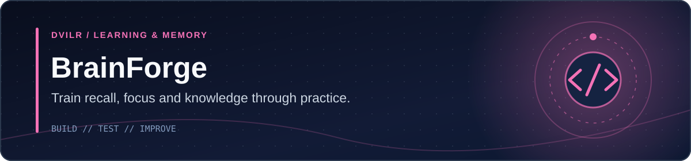

<!-- DVILR PROJECT COVER v1 -->
<p align="center"></p>
<p align="center"><a href="https://github.com/dvilrgamerz"><strong>Developer profile</strong></a> · <a href="https://github.com/dvilrgamerz/brainrot"><strong>Source</strong></a></p>
<!-- /DVILR PROJECT COVER -->

# BrainForge V2 🧠

**Train. Learn. Remember.**

BrainForge is a dependency-free, production-quality, local-first learning and cognitive-training web application. It is engineered around genuine active recall, deterministic answer validation, adaptive difficulty calibration, and spaced repetition.

---

## ⚡ What's New in V2

- **Modular Static Architecture:** Zero frameworks, zero bundlers, pure native ES modules (`js/`).
- **Curriculum Bank (260+ Questions):**
  - **Mental Math:** Procedural math engine generating 14 topics with 5 difficulty levels, step-by-step explanations, and concept-level memory deduplication.
  - **Science (60 questions):** Physics, Chemistry, Biology, Earth Science, Astronomy with evidence explanations.
  - **General Knowledge (55 questions):** Geography, World History, Cultures, Tech Evolution, Critical Thinking.
  - **Computer Science (55 questions):** Algorithms, Data Structures, CPU & Memory, OS, Networking, Databases, Security.
  - **Coding Practice (56 questions):** JavaScript & Python output prediction, bug identification, edge cases, code tracing.
- **Enhanced Spaced Repetition Engine (SRS):**
  - Standard 8-level Leitner schedule (`0 → 1 → 3 → 7 → 14 → 30 → 60 → 90` days).
  - 4-tier recall grading: `Again` (&lt;10m), `Hard` (1d), `Good` (3d), `Easy` (7d+).
  - Rolling 10-review history and lapse tracking stored in UTC ISO format.
- **Adaptive Practice Engine:**
  - Concept-level mastery evaluation (attempts, streak, accuracy, latency).
  - Deterministic progression rules: 3+ consecutive correct to level up, 2+ consecutive errors to step down.
- **Listening Mode:**
  - Browser-native SpeechSynthesis with sentence-by-sentence tracking and highlighting.
  - Variable speed (`0.75×` to `2×`) and real-time pitch slider (`0.5` to `1.5`).
  - 18 comprehensive lessons with no-looking active recall prompts.
- **Distraction-Free Focus Mode:**
  - Minimalist cognition chamber with configurable countdown timer, keyboard shortcuts, and grayscale toggle.
- **Personalized Study Planner:**
  - Generates balanced training workouts for 5, 10, 15, 25, or 45-minute targets.
  - Overrides for review backlog focus, mental math warmup, and difficulty filtering.
- **Custom Flashcard Vault:**
  - Create, tag, filter, review, and delete personal cards in IndexedDB.
- **System-Adaptive Theme System:**
  - Automatic Dark/Light mode matching OS preference, with manual cycle toggle.
  - Full WCAG AA color contrast compliance, reduce-motion support, and grayscale mode.
- **Offline PWA:**
  - Installable application with service worker v3 caching and standalone manifest icons.
- **Zero Tracker / Account-Free Privacy:**
  - 100% stored in IndexedDB (`brainforge-db` v2) and localStorage.
  - Full JSON backup export and validated import with XSS sanitization.

---

## 🧠 Memory Schedule

| Level | Interval | Description |
|---|---|---|
| **0** | Same day | New or lapsed concept |
| **1** | 1 day | Initial successful recall |
| **2** | 3 days | Short-term consolidation |
| **3** | 7 days | Weekly retention checkpoint |
| **4** | 14 days | Bi-weekly reinforcement |
| **5** | 30 days | Monthly retention milestone |
| **6** | 60 days | Long-term memory transfer |
| **7** | 90 days | Consolidated knowledge base |

---

## 🛠️ Running Locally

BrainForge requires no build step or package installations. Serve the directory with any static web server:

```bash
# Using Python
python -m http.server 5173

# Using Node
npx serve -l 5173 .
```

Then navigate to `http://localhost:5173`.

---

## 🧪 Automated Testing

BrainForge includes comprehensive unit and integration test suites executed with Node's native test runner (`node:test`):

```bash
# Run all 8 test suites (80+ unit and integration tests)
node --test tests/*.test.mjs

# Syntax check all modules and service worker
node --check sw.js js/*.js
```

---

## 🔒 Data & Privacy

- No sign-ups or user accounts required.
- All learning attempts, recall history, and custom cards remain strictly on your device.
- Use **Settings → Export backup** to download a portable JSON copy of your progress.